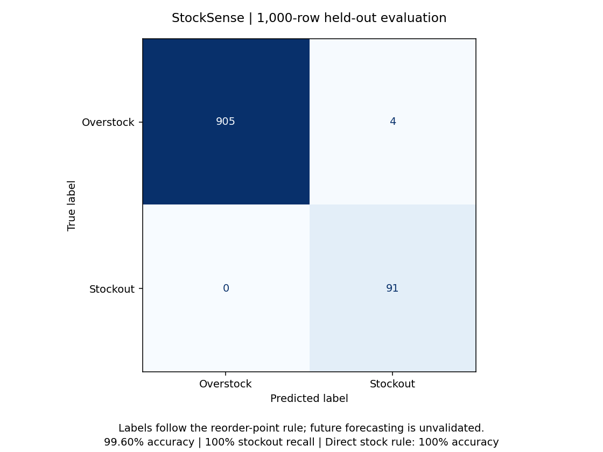

# StockSense — Inventory Risk Classification

A deployable Streamlit adaptation of Ashutosh Mahanta's existing Google Colab inventory-management project.

## Evaluation figure



Computed from the committed evaluation report. This is a result figure, not a dashboard screenshot. The direct reorder-point rule scores 100% on the same holdout.

## Run locally

Use Python 3.12. From this directory:

```bash
python -m pip install -r requirements.txt
python -m streamlit run app.py
```

From the repository root, use `python -m streamlit run projects/inventory-management/app.py`.

## Deploy on Streamlit Community Cloud

1. Open https://share.streamlit.io and sign in with GitHub.
2. Create an app from repository `ashutoshmahanta714-bit/ashutoshmahanta714-bit`.
3. Select branch `main`.
4. Set entrypoint to `projects/inventory-management/app.py`.
5. Under Advanced settings, select Python 3.12, then deploy.

Dependencies are declared beside the entrypoint. No secrets or external APIs are required. The app loads the four committed fitted PKL files and caches them per server process. It does not train on startup. Cloud deployment has not been performed or verified by this repository upload.

## Features

- Dataset overview and season filter.
- Single-product classification with an explicit stock-rule comparison.
- CSV/XLSX batch uploads, validated inputs, and prediction downloads.
- Five-fold training-only Logistic Regression tuning.
- Held-out confusion matrix, stockout recall/F1, majority baseline, and direct-rule benchmark.
- Original Colab notebook with outputs cleared, preserving source code and analysis narrative.

## Source and changes

Source: `Inventory_Management_Previous_Code.ipynb`, modified 20 October 2026, in the user's Colab Notebooks folder. Also inspected Inventory_Management_1 and Inventory_Management_2. The source compares Logistic Regression, Decision Tree, Random Forest, and SVC and prefers tuned Logistic Regression. The app retains that model, balanced class weights, C/solver grid, five-fold stockout-F1 scoring, and the 80/20 stratified split with seed 100.

The saved OrdinalEncoder is fitted on the training split, matching the supplied notebook. The saved Logistic Regression pipeline contains StandardScaler, fitted inside each training cross-validation fold; inference applies the encoder once and scaling once. The app does not repeat the source's large tree/forest/SVC searches at startup. The source notebook retains those experiments. Notebook plotting requires matplotlib and seaborn in addition to app requirements.

## Dataset and interpretation

The supplied training dataset has 5,000 records and 10 features, with 4,543 overstock labels and 457 stockout labels. Source provenance and redistribution licence were not supplied; no licence to the underlying dataset is asserted here.

Every supplied label follows `current_stock < reorder_point` -> stockout, otherwise overstock. No equality cases exist in training. The app identifies equality separately in the direct-rule output and asks for manual review. Above the reorder point is not sufficient evidence of excess stock in an actual business.

This is a current-state classification learning project, not validated future-risk forecasting. It contains no healthy-stock class, product/time identifiers, independently observed future outcomes, or validated cost-saving model. Class-weighted probability scores are not calibrated business probabilities. Recommendations are review prompts, not automatic purchase decisions.

## Reproduced evaluation

The 1,000-row holdout gives Logistic Regression 99.60% accuracy, 100% stockout recall, and 97.85% stockout F1 (91 stockouts detected, four false alerts). The explicit stock rule gives 100% accuracy. These results primarily demonstrate learning of the dataset's label rule and do not establish real-world forecasting performance. Full results: `evaluation.json`.

## Verify

```bash
python -m unittest test_app -v
python model.py  # Read the saved evaluation; no training
```

Tests cover held-out sample sizes, the label-rule check, invalid uploads, finite numeric values, matching batch/single inference, equality and zero-demand handling, all four Streamlit pages, and form submission. Uploaded rows are processed in server memory and not saved to disk by the app. Do not upload confidential inventory to an untrusted hosted instance.

## Next steps

Collect timestamped product-level inventory, orders, receipts, and observed stockout outcomes. Define a future prediction horizon and a healthy-stock class, verify each feature is available at prediction time, and evaluate on later dates and unseen products against the reorder-point rule. Add procurement and holding costs before estimating business savings.


## Saved deployment files

| File | Purpose |
|---|---|
| `best_lr_model.pkl` | Fitted tuned Logistic Regression pipeline, including StandardScaler |
| `ordinal_encoder.pkl` | Fitted category-to-number mappings |
| `label_encoder.pkl` | Maps 0 to overstock and 1 to stockout |
| `feature_columns.pkl` | Preserves the ten input columns in training order |

No separate scaler PKL is needed. Use these four files together. They were generated using scikit-learn 1.8.0, pinned in requirements.txt. Only load trusted pickle files.

`model.py` validates inputs, loads the four files, and supports predictions for the Streamlit interface. `train_model.py` recreates the artifacts offline from the supplied Excel dataset. `evaluation.json` provides the app's evaluation table; `validation_results.json` records export metrics and reload verification. The data, notebook and evaluation figure remain available as supporting project materials.

Recreate the deployment artifacts from this directory:

```bash
python train_model.py "stock_risk_prediction_dataset (1).xlsx"
```

The export uses the original 4,000-row training split. Predictions after reloading match all 1,000 held-out predictions. On the full 5,000 rows (including training data), the model predicts 480 stockouts and 4,520 overstocks; actual labels are 457 and 4,543. Full-dataset counts are not independent evaluation.
